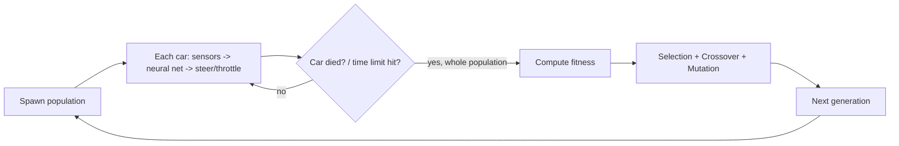

# UnityCarEvolution

[](LICENSE)
[](https://unity.com)
[](README.en.md)

**Language / Dil:** English · [Türkçe](README.md)

A top-down 2D car-driving simulation (top-down camera, real 3D `WheelCollider` physics underneath) where cars evolve to drive using raycast distance sensors, a small feedforward neural network, and a classic genetic algorithm.

### Overview

Each car has 3-7 forward-facing raycast sensors that measure distance to the track walls. Those readings feed a small feedforward neural network (inputs: sensor distances, outputs: steering angle + throttle/brake) that drives the car. The network's weights are trained with a classic genetic algorithm: a population of cars drives in parallel every generation, the best performers are selected, and the next generation is produced via crossover + mutation.

The project also includes an open, point-to-point **maze mode**: all cars spawn from the exact same point and try to reach a single finish point, with an A* pathfinder shaping the fitness signal toward the goal (A* only scores progress — it never drives the car; the neural network + GA remain fully in control of driving).

### Requirements

- Unity Editor **6000.3.1f1** ("Unity 6.3 LTS") or a compatible Unity 6 version.
- The project uses `WheelCollider`, so `com.unity.modules.vehicles` must stay listed in `Packages/manifest.json` (it's already there).

### Setup

1. Open this folder in Unity Hub ("Add project from disk").
2. Run these menu items in order from the top menu bar:
   - **Car Evolution > 1. Create Data Assets (Profiles + Tracks)** — creates the Formula/Rally/Snowmobile vehicle profiles under `Assets/Data/Profiles`, and the WideOval / TightChicane / **Maze1** track assets under `Assets/Data/Tracks`.
   - **Car Evolution > 2. Build Simulation Scene** — builds `Assets/Scenes/MainScene.unity` from scratch: track (WideOval), car prefab (with `WheelCollider`s), `PopulationManager`, `SimulationConfig`, top-down camera, HUD canvas.
   - **Car Evolution > 3. Build Maze Scene** — builds `Assets/Scenes/MazeScene.unity` the same way but using the `Maze1` track (see [Maze mode](#maze-mode-single-start--finish-a-guided-reward) below).
3. Press **Play**. The first generation starts immediately; the HUD (top-left) shows the current generation number, best fitness, how many cars are still alive, and live stats for the current best car.

All three menu items are idempotent for assets: they won't recreate a profile/track asset that already exists. Building a scene, however, always rebuilds that `.unity` file from scratch (so any manual edits you made directly in that scene get overwritten — re-run the menu item any time you want a fresh scene).

> **Note:** the scene files currently committed in the repo are named `OvalScene.unity` / `MazeScene.unity` (the scene the menu item builds as `MainScene` appears to have been renamed by hand to `OvalScene` at some point). Re-running the menu item will create a fresh `MainScene.unity`.

### Architecture

```
Assets/Scripts/
  Sensors/CarSensors.cs          - fires N raycasts, returns normalized distances
  NeuralNet/NeuralNetwork.cs     - input -> hidden(tanh) -> output(tanh), flat float[] weights
  GA/Genome.cs, GeneticAlgorithm.cs
                                  - elitism + tournament selection + crossover + mutation
  Car/VehicleProfile.cs          - Formula/Rally/Snowmobile: WheelCollider parameters
  Car/CarController.cs           - steer + throttle/brake -> WheelCollider physics
  Car/CarAgent.cs                - ties sensors+brain+controller together, computes fitness
  Track/TrackDefinition.cs       - a track = 2D centerline + width (data-only asset)
  Track/TrackBuilder.cs          - turns a centerline into walls + road mesh + checkpoints
  Track/CheckpointTrigger.cs
  Pathfinding/MazeGrid.cs        - walkable/blocked cell grid built from a centerline
  Pathfinding/AStarPathfinder.cs - A* (FindPath) + a Dijkstra-equivalent bulk distance field
  Pathfinding/GoalDistanceField.cs - "true (maze-aware) distance to the finish" - O(1) lookup
  Simulation/SimulationConfig.cs - every Inspector-configurable parameter
  Simulation/PopulationManager.cs - the generation loop: spawn -> simulate -> evolve
  UI/SimulationHUD.cs            - generation/fitness text + the best car's sensor rays
  Benchmark/BenchmarkReportUI.cs - compares two PopulationManagers side by side
Assets/Editor/CarEvolutionSetup.cs
                                  - one-click data asset + scene bootstrap (MainScene + MazeScene)
```

The generation loop, in short:



On a **closed-loop track** (WideOval, TightChicane), fitness = distance covered + checkpoints passed * bonus + survival time. On the **open maze track**, fitness is instead driven by real A*-measured progress toward the finish (see [Maze mode](#maze-mode-single-start--finish-a-guided-reward)). Either way, a car "dies" (`IsAlive = false`) when it hits a wall, gets physically launched off the track, or stays nearly stationary for `stuckTimeout` seconds. A generation ends when the whole population has died or `generationTimeLimit` runs out, and the GA produces the next generation.

### Maze mode (single start -> finish, A*-guided reward)

The `Maze1` track (built into `MazeScene` by menu item 3) isn't a closed lap — it's an open (`closedLoop: false`) corridor with right-angle turns, similar to a black-and-white maze/pipe reference image (black = wall, white = drivable corridor).

- **All cars spawn from the exact same point** (`centerline[0]`). This is safe because car-vs-car collisions are already disabled (`Physics.IgnoreLayerCollision` makes the "Car" layer not collide with itself), so stacking on top of each other on spawn causes no issue.
- **The finish point** is the last element of the centerline. When the track is open (`closedLoop == false`), `PopulationManager.Start()` builds a `GoalDistanceField`: it rasterizes the track into a grid (`MazeGrid`) and runs `AStarPathfinder.ComputeDistanceField` (a flood outward from the goal — A* with a zero heuristic, i.e. Dijkstra) **once per generation**, computing the true (wall-aware) distance from every cell to the finish. Every car then looks this up in O(1) every frame.
- **A* only shapes the reward signal — it never drives the car.** This is a deliberate design choice: the neural network + GA remain fully in control of driving; A* just tells them "how much closer to the finish did you get" (`CarAgent.ProgressFitness`) — actually learning how to drive is still entirely up to evolution.
- Reward is granted only when a car reaches a **new personal-best distance** to the goal (not on raw distance change), so wiggling back and forth near the start earns nothing — only real progress (even indirect, like going around a corner) is rewarded.
- Getting within `goalReachedDistance` (default 1.5m) of the finish sets `ReachedGoal = true` and grants a large flat bonus (+500).
- On closed-loop tracks (`WideOval`, `TightChicane`) `goalField` is never built, and `CarAgent.ComputeFitness()` automatically falls back to the original checkpoint-index-based fitness — the maze code doesn't affect the existing tracks.
- The maze's first centerline point sits 6 units in from the true open edge (`(0, 6)` rather than `(0, 0)`): the road mesh only exists *between* centerline points, so a car spawned too close to the very start has its rear half hanging off the edge with no ground under the (motor-driven) rear wheels — no traction, so it never moves no matter what the network outputs. 6 units of clearance reliably keeps the whole car body on solid road from the first frame.

### The 5 original requirements — current status

1. **Track(s):** `TrackBuilder` is fully data-driven; a `TrackDefinition` asset is just a centerline + width. The editor script creates a tight-turn track (`TightChicane`), a wide one (`WideOval`), and an open point-to-point maze (`Maze1`) — each with its own scene-builder menu item.
2. **Inspector parameters:** the `SimulationConfig` component (on the `SimulationConfig` GameObject in the scene) exposes generation count, sensor count, population size, mutation rate/strength, elitism, tournament size, and the save/load persistence settings, all from the Inspector. (Note: changing sensor count also updates `CarSensors.sensorCount`, but the network's input size needs to be set before pressing Play — live mid-run changes aren't supported yet.)
3. **HUD:** `SimulationHUD` shows the generation number, best fitness ever, how many cars are alive right now, and live diagnostics (speed, stuck timer, distance) for the current best car. `sensorRayVisuals` (an array of `LineRenderer`s) can draw the best car's sensor rays, but nothing is wired into that array by the scene builder yet.
4. **Vehicle physics profiles:** `VehicleProfile` (a ScriptableObject) plus 3 ready-made assets (Formula/Rally/Snowmobile) are created automatically. Changing `SimulationConfig.vehicleProfile` and pressing Play again switches the profile — a live in-game dropdown to switch profiles at runtime isn't implemented yet.
5. **Benchmark mode:** `PopulationManager.CompletionRate` (the fraction of cars that finished the track) is already computed, and `BenchmarkReportUI` compares two `PopulationManager`s side by side. Fully automating "run two configs back-to-back or in parallel" isn't implemented yet — for now you'd wire up two separate `PopulationManager` + `SimulationConfig` + track setups by hand and connect them to `BenchmarkReportUI`.

### Training persistence (save/load)

The **Persistence** section on `SimulationConfig` means training doesn't restart from scratch on every Stop/Play or Editor restart:

- At the end of every generation (`PopulationManager.FinishGeneration()`), if `saveProgress` is on (default: on), the current population's full weights + fitness, generation number, and best fitness ever are written to `Application.persistentDataPath` as `population_<track name>.json` (one file per track — use `saveSlotName` to give it a custom name if you're running multiple experiments on the same track).
- If `loadSavedProgress` is on (default: on), `PopulationManager.Start()` tries to read that file first; if it exists and its weight count per genome (which depends on `sensorCount`/`hiddenLayerSize`) still matches, it resumes the population and generation counter right where they left off. If it doesn't match (e.g. you changed the sensor count), a warning is logged and it starts fresh with a new random population — your old save file isn't deleted, just ignored.
- To start completely from scratch: delete the relevant `population_*.json` file under `Application.persistentDataPath` (on Windows, typically `%userprofile%\AppData\LocalLow\<company name>\UnityCarEvolution\`), or turn off `loadSavedProgress`.

### What's next (making it more parametric)

- Making sensor count/population/track selection choosable before Play, from an Editor window or runtime dropdowns.
- A "Car Evolution > 4. Build Benchmark Scene" menu item that automatically builds a second scene/`PopulationManager` for `TightChicane`.
- Fully automating benchmark mode: running two configs back-to-back (or in accelerated parallel via `Time.timeScale`) and showing a summary screen automatically when done.
- A simple in-Scene-view track editor (dragging centerline points around) — tracks are currently defined purely through code/assets.
- Real vehicle visuals (currently a plain box + wheel anchors) instead of a placeholder mesh/prefab.

### References

This project uses no third-party packages, libraries, or datasets beyond Unity's own built-in engine modules (no Unity ML-Agents, for instance — learning is done entirely with the hand-written neural network + genetic algorithm code in this repo).

| Dependency | Purpose | License | Link |
|---|---|---|---|
| Unity Editor (6000.3.1f1, "Unity 6.3 LTS") | Game engine / runtime — 3D physics (`WheelCollider`), rendering, UI | Unity Software License Agreement (the engine itself is closed-source; the project code you write on top is yours) | https://unity.com/legal |
| `com.unity.modules.vehicles`, `com.unity.ugui`, and the other `com.unity.modules.*` entries (`Packages/manifest.json`) | Standard built-in Unity modules for `WheelCollider`, UI, 2D/3D physics, animation, etc. | Same license as the Unity engine (not a separate package, bundled with the engine) | `Packages/manifest.json` |

All **C# source** in this repository (`Assets/Scripts/`, `Assets/Editor/`) is original work by the author and is licensed under the MIT license in [LICENSE](LICENSE).

### Attribution

This project was inspired by the "AI Learns To Drive" style genetic-algorithm / neuroevolution car simulation videos shared by the `activation_function` account on Instagram. The code, architecture, and content in this repository are the author's own and have no official affiliation with that account.

### Notes

- Because the project uses `WheelCollider`, `com.unity.modules.vehicles` is explicitly listed in `Packages/manifest.json` — without it, `WheelCollider` won't compile.
- The "Wall" tag is created automatically by the editor script (by editing `ProjectSettings/TagManager.asset`) — you don't need to add it by hand.
- `.gitignore` includes the standard Unity ignore list, so `Library/`, `Temp/`, and similar folders won't be committed if you push this to git.
