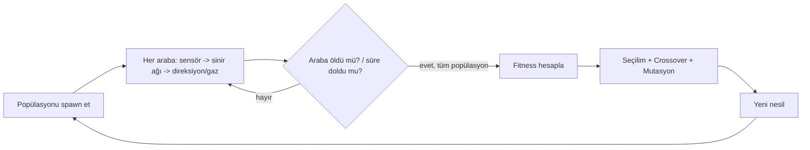

# UnityCarEvolution

[](LICENSE)
[](https://unity.com)
[](README.md)

**Dil / Language:** Türkçe · [English](README.en.md)

Üstten görünümlü (top-down kamera, altında gerçek 3D `WheelCollider` fiziği olan) bir 2D araba-sürüş simülasyonu; arabalar raycast mesafe sensörleri, küçük bir feedforward sinir ağı ve klasik bir genetik algoritma kullanarak sürmeyi öğreniyor.

### Genel Bakış

Her arabanın önüne yerleştirilmiş 3-7 arası raycast sensör, pist duvarlarına olan mesafeyi ölçer. Bu sensör verileri, küçük bir feedforward sinir ağına (girdi: sensör mesafeleri, çıktı: direksiyon açısı + gaz/fren) girdi olarak verilir ve arabayı bu ağ kontrol eder. Ağın ağırlıkları klasik bir genetik algoritma ile eğitilir: her nesilde bir popülasyon araba paralel olarak sürer, en iyi performans gösterenler seçilir, sonraki nesil çaprazlama + mutasyonla üretilir.

Proje ayrıca açık, tek başlangıç noktasından tek bitiş noktasına giden bir **labirent modu** içeriyor: tüm araçlar birebir aynı noktadan başlayıp tek bir bitiş noktasına ulaşmaya çalışıyor, bir A* yol bulma algoritması da fitness sinyalini hedefe doğru şekillendiriyor (A* sadece ilerlemeyi puanlıyor — arabayı asla sürmüyor; sürüşün tamamı hâlâ sinir ağı + GA'nın kontrolünde).

### Gereksinimler

- Unity Editor **6000.3.1f1** ("Unity 6.3 LTS") veya uyumlu bir Unity 6 sürümü.
- Proje `WheelCollider` kullandığı için `com.unity.modules.vehicles`'ın `Packages/manifest.json` içinde listeli kalması gerekiyor (zaten ekli).

### Kurulum

1. Unity Hub'da bu klasörü ("Add project from disk") proje olarak aç.
2. Üstteki menüden sırayla çalıştır:
   - **Car Evolution > 1. Create Data Assets (Profiles + Tracks)** — `Assets/Data/Profiles` altında Formula/Rally/Snowmobile araç profillerini, `Assets/Data/Tracks` altında WideOval / TightChicane / **Maze1** pist asset'lerini oluşturur.
   - **Car Evolution > 2. Build Simulation Scene** — `Assets/Scenes/MainScene.unity` sahnesini sıfırdan kurar: pist (WideOval), araba prefabı (`WheelCollider`'lı), `PopulationManager`, `SimulationConfig`, top-down kamera, HUD canvas.
   - **Car Evolution > 3. Build Maze Scene** — `Assets/Scenes/MazeScene.unity`'yi aynı şekilde ama `Maze1` pistiyle kurar (aşağıdaki [Labirent modu](#labirent-modu-aynı-başlangıç-noktası---bitiş-a-yönlendirmeli-ödül) bölümüne bak).
3. **Play** tuşuna bas. İlk nesil hemen başlar; HUD (sol üstte) o anki nesil numarasını, şimdiye kadarki en iyi fitness'ı, kaç aracın hâlâ hayatta olduğunu ve o anki en iyi aracın canlı istatistiklerini gösterir.

Bu üç menü öğesi asset'ler için idempotent: zaten var olan bir profil/pist asset'ini tekrar oluşturmaz. Sahne kurma işlemi ise her çalıştırıldığında ilgili `.unity` dosyasını sıfırdan yeniden kurar (o sahne üzerinde elle yaptığın değişiklikler üzerine yazılır — sahneyi yenilemek istediğinde menü öğesini tekrar çalıştırman yeterli).

> **Not:** Depodaki sahne dosyalarının adı şu an `OvalScene.unity` / `MazeScene.unity` (editor menüsünün `MainScene` ismiyle kurduğu sahne, bir noktada elle `OvalScene` olarak yeniden adlandırılmış görünüyor). Menü öğesini yeniden çalıştırırsan `MainScene.unity` adıyla yeni bir sahne oluşturulur.

### Mimari

```
Assets/Scripts/
  Sensors/CarSensors.cs          - N adet raycast atar, normalize mesafe döndürür
  NeuralNet/NeuralNetwork.cs     - girdi -> gizli(tanh) -> çıktı(tanh), flat float[] ağırlık
  GA/Genome.cs, GeneticAlgorithm.cs
                                  - elitism + turnuva seçilim + crossover + mutasyon
  Car/VehicleProfile.cs          - Formula/Rally/Snowmobile: WheelCollider parametreleri
  Car/CarController.cs           - steer + gaz/fren -> WheelCollider fiziği
  Car/CarAgent.cs                - sensör+ağ+kontrolcüyü birleştirir, fitness hesaplar
  Track/TrackDefinition.cs       - pist = 2D centerline + genişlik (data-only asset)
  Track/TrackBuilder.cs          - centerline'dan duvar + yol mesh + checkpoint üretir
  Track/CheckpointTrigger.cs
  Pathfinding/MazeGrid.cs        - centerline'dan walkable/blocked hücre grid'i
  Pathfinding/AStarPathfinder.cs - A* (FindPath) + Dijkstra-eşdeğeri toplu mesafe alanı
  Pathfinding/GoalDistanceField.cs - "bitişe olan gerçek (labirent-farkında) mesafe" - O(1) lookup
  Simulation/SimulationConfig.cs - Inspector'dan ayarlanabilir tüm parametreler
  Simulation/PopulationManager.cs - nesil döngüsü: spawn -> simüle et -> evolve
  UI/SimulationHUD.cs            - nesil/fitness metni + en iyi aracın sensör ışınları
  Benchmark/BenchmarkReportUI.cs - iki PopulationManager'ı yan yana karşılaştırır
Assets/Editor/CarEvolutionSetup.cs
                                  - tek tıkla veri asset'leri + sahne kurulumu (MainScene + MazeScene)
```

Nesil döngüsü kısaca şöyle işliyor:



**Kapalı-tur pistlerde** (WideOval, TightChicane) fitness = kat edilen mesafe + geçilen checkpoint sayısı * bonus + hayatta kalma süresi. **Açık labirent pistinde** ise fitness, bitişe doğru gerçek A*-ölçümlü ilerlemeyle belirleniyor (bkz. [Labirent modu](#labirent-modu-aynı-başlangıç-noktası---bitiş-a-yönlendirmeli-ödül)). Her iki durumda da bir araba duvara çarptığında, pistten fiziksel olarak fırlatıldığında ya da `stuckTimeout` saniye boyunca neredeyse hareketsiz kaldığında "ölür" (`IsAlive = false`). Tüm popülasyon öldüğünde ya da `generationTimeLimit` dolduğunda nesil biter ve GA bir sonraki nesli üretir.

### Labirent modu (aynı başlangıç noktası -> bitiş, A* yönlendirmeli ödül)

`Maze1` pisti (3 numaralı menü öğesiyle `MazeScene` içine kurulur) kapalı bir tur değil — dik açılı virajlarla ilerleyen açık (`closedLoop: false`) bir koridor, siyah-beyaz bir labirent/boru görseline benzer şekilde (siyah = pist duvarı, beyaz = pistin yolu).

- **Tüm araçlar birebir aynı noktadan** (`centerline[0]`) başlıyor. Bu güvenli, çünkü araç-araç çarpışmaları zaten kapalı (`Physics.IgnoreLayerCollision` ile "Car" layer'ı kendisiyle çarpışmıyor) — üst üste spawn olmaları sorun yaratmıyor.
- **Bitiş noktası** centerline'ın son elemanı. Pist açık (`closedLoop == false`) olduğunda `PopulationManager.Start()` bir `GoalDistanceField` kuruyor: `MazeGrid` ile pisti hücrelere bölüp, `AStarPathfinder.ComputeDistanceField` (bitişten dışarı doğru çalışan, A*'ın sıfır-heuristik hali = Dijkstra) ile **her hücreden bitişe olan gerçek (duvarları dolanan) mesafeyi**, nesil başına bir kere hesaplıyor. Her araç bunu her frame'de O(1) sorguluyor.
- **A* SADECE ödül sinyalini şekillendiriyor, arabayı sürmüyor** — bilinçli bir tasarım kararı: sürüşün tamamı hâlâ sinir ağı + GA'nın kontrolünde; A* onlara sadece "bitişe ne kadar yaklaştın" diye bir puan veriyor (`CarAgent.ProgressFitness`) — sürmeyi öğrenmek tamamen evrimin işi olarak kalıyor.
- Ödül sadece **yeni bir kişisel-en-iyi mesafeye** ulaşınca veriliyor (ham mesafe değişimi değil) — böylece başlangıç noktasının yakınında ileri-geri sallanmak hiçbir ödül kazandırmıyor, gerçek ilerleme (bir köşeyi dönmek gibi dolaylı olsa bile) ödüllendiriliyor.
- Bitişe `goalReachedDistance` (varsayılan 1.5m) kadar yaklaşınca `ReachedGoal = true` olur ve büyük bir sabit bonus (+500) kazanılır.
- Kapalı-tur pistlerde (`WideOval`, `TightChicane`) `goalField` hiç kurulmaz, `CarAgent.ComputeFitness()` otomatik olarak eski checkpoint-index tabanlı fitness'a düşer — labirent kodu mevcut pistleri etkilemez.
- Labirentin ilk centerline noktası, gerçek açık uçtan 6 birim içeride duruyor (`(0, 0)` yerine `(0, 6)`): yol mesh'i sadece centerline noktaları *arasında* var, bu yüzden başlangıca çok yakın spawn olan bir aracın gövdesinin arka yarısı, altında zemin olmayan bir şekilde açık uçtan sarkar — motor torku uygulanan arka tekerlekler havada kalınca hiçbir çekiş oluşmaz ve araç, sinir ağı ne çıktı verirse versin hiç hareket etmez. 6 birimlik bir boşluk, aracın tüm gövdesinin daha ilk kareden itibaren sağlam yolun üzerinde kalmasını güvenilir şekilde sağlıyor.

### İstenen 5 madde — şu anki durum

1. **Pist(ler):** `TrackBuilder` tamamen data-driven; bir `TrackDefinition` asset'i sadece bir centerline + genişlik. Editor scripti dar-virajlı bir pist (`TightChicane`), geniş bir pist (`WideOval`) ve açık, tek başlangıç-tek bitişli bir labirent (`Maze1`) oluşturuyor — her biri kendi sahne kurma menü öğesine sahip.
2. **Inspector parametreleri:** sahnedeki `SimulationConfig` GameObject'i üzerindeki `SimulationConfig` component'i — nesil sayısı, sensör sayısı, popülasyon büyüklüğü, mutasyon oranı/gücü, elitism, turnuva boyutu ve save/load kalıcılık ayarlarının hepsi Inspector'dan ayarlanabilir. (Not: sensör sayısını değiştirmek `CarSensors.sensorCount`'u da güncelliyor, ama ağın girdi boyutu Play'e basılmadan önce ayarlanmalı — oyun sırasında canlı değiştirme henüz desteklenmiyor.)
3. **HUD:** `SimulationHUD` nesil numarasını, şimdiye kadarki en iyi fitness'ı, o an kaç aracın hayatta olduğunu ve o anki en iyi aracın canlı tanı bilgilerini (hız, sıkışma sayacı, mesafe) gösteriyor. `sensorRayVisuals` (bir `LineRenderer` dizisi) en iyi aracın sensör ışınlarını çizebilir, ama sahne kurucusu bu diziye henüz hiçbir şey bağlamıyor.
4. **Araç fizik profilleri:** `VehicleProfile` (bir ScriptableObject) ve 3 hazır asset (Formula/Rally/Snowmobile) otomatik oluşturuluyor. `SimulationConfig.vehicleProfile` alanını değiştirip Play'e tekrar basmak profili değiştirir — çalışma zamanında canlı bir dropdown ile geçiş henüz uygulanmadı.
5. **Benchmark modu:** `PopulationManager.CompletionRate` (pisti bitiren araçların oranı) zaten hesaplanıyor, `BenchmarkReportUI` iki `PopulationManager`'ı yan yana karşılaştırıp raporluyor. "İki config'i art arda veya paralel çalıştırmayı" tamamen otomatik hale getirmek henüz yapılmadı — şu an için iki ayrı `PopulationManager` + `SimulationConfig` + pist kurulumunu elle yapıp `BenchmarkReportUI`'a bağlaman gerekiyor.

### Eğitimin kalıcı hale getirilmesi (Save/Load)

`SimulationConfig` üzerindeki **Persistence** bölümü sayesinde eğitim her Stop/Play'de veya Editor'ü kapatıp açtığında sıfırdan başlamıyor:

- Her nesil bitiminde (`PopulationManager.FinishGeneration()`), `saveProgress` açıksa (varsayılan: açık) o anki popülasyonun tüm ağırlıkları + fitness'ları, nesil numarası ve şimdiye kadarki en iyi fitness `Application.persistentDataPath` altına `population_<pist adı>.json` olarak yazılır (pist başına ayrı dosya — aynı pistte birden fazla deney yürütüyorsan `saveSlotName` alanıyla özel bir isim verebilirsin).
- `loadSavedProgress` açıksa (varsayılan: açık), `PopulationManager.Start()` önce bu dosyayı okumayı dener; varsa ve genom başına ağırlık sayısı (`sensorCount`/`hiddenLayerSize`'a bağlı) hâlâ uyuşuyorsa, popülasyonu ve nesil sayacını kaldığı yerden devam ettirir. Uyuşmuyorsa (örneğin sensör sayısını değiştirdiysen) bir uyarı loglar ve rastgele yeni bir popülasyonla baştan başlar — eski dosyan silinmez, sadece görmezden gelinir.
- Sıfırdan başlamak istersen: `Application.persistentDataPath` klasöründeki ilgili `population_*.json` dosyasını sil (Windows'ta genelde `%userprofile%\AppData\LocalLow\<şirket adı>\UnityCarEvolution\`), ya da `loadSavedProgress`'i kapat.

### Sırada ne var (parametrik hale getirme)

- Sensör sayısı/popülasyon/pist seçimini bir Editor penceresinden veya runtime dropdown'lardan Play öncesi seçilebilir hale getirmek.
- `TightChicane` için otomatik ikinci bir sahne/`PopulationManager` kuran bir "Car Evolution > 4. Build Benchmark Scene" menü öğesi.
- Benchmark modunu tamamen otomatik hale getirmek: iki config'i art arda (veya `Time.timeScale` ile hızlandırılmış paralel) çalıştırıp bitince özet ekranını otomatik göstermek.
- Basit bir Scene-view pist editörü (centerline noktalarını sürükleyip bırakma) — şu an pistler sadece kod/asset üzerinden tanımlanıyor.
- Gerçek araç görselleri (şu an sade bir kutu + tekerlek anchor'ları) — yer tutucu mesh/prefab yerine gerçek bir modelle değiştirmek.

### Kaynakça / Referanslar

Bu proje, Unity'nin kendi dahili motor modülleri dışında herhangi bir üçüncü taraf paket, kütüphane veya veri seti kullanmıyor (örn. Unity ML-Agents eklenmemiştir — öğrenme tamamen bu depodaki el yazımı sinir ağı + genetik algoritma koduyla yapılıyor).

| Bağımlılık | Amaç | Lisans | Link |
|---|---|---|---|
| Unity Editor (6000.3.1f1, "Unity 6.3 LTS") | Oyun motoru / çalışma zamanı — 3D fizik (`WheelCollider`), render, UI | Unity Yazılım Lisans Sözleşmesi (motorun kendisi kapalı kaynak; üstüne yazdığınız proje kodu size aittir) | https://unity.com/legal |
| `com.unity.modules.vehicles`, `com.unity.ugui` ve diğer `com.unity.modules.*` girdileri (`Packages/manifest.json`) | `WheelCollider`, UI, 2D/3D fizik, animasyon gibi standart Unity dahili modülleri | Unity motoruyla aynı lisans (ayrı bir paket değil, motora gömülü) | `Packages/manifest.json` |

Bu depodaki **tüm C# kodu** (`Assets/Scripts/`, `Assets/Editor/`) yazarın kendi çalışmasıdır ve aşağıdaki [LICENSE](LICENSE) dosyasındaki MIT lisansı altındadır.

### Atıf

Bu proje, Instagram'daki `activation_function` hesabının paylaştığı "AI Learns To Drive" tarzı genetik-algoritma/nöroevrim araba simülasyonu videolarından esinlenilmiştir. Bu depodaki kod, mimari ve içerik tamamen bu projeye özgüdür; bahsi geçen hesapla resmi bir bağlantısı yoktur.

### Notlar

- Proje `WheelCollider` kullandığı için `com.unity.modules.vehicles`, `Packages/manifest.json` içinde açıkça listelendi — bu modül olmadan `WheelCollider` derlenmez.
- "Wall" tag'i editor scripti tarafından otomatik oluşturuluyor (`ProjectSettings/TagManager.asset` düzenlenerek), elle eklemene gerek yok.
- `.gitignore` standart Unity ignore listesini içeriyor — bu projeyi git'e/GitHub'a bağlarsan `Library/`, `Temp/` gibi klasörler commit'lenmez.
